# Вариант 24: база для понимания и защиты

## 1. Что вообще нужно было сделать

Не свой менеджер установки пакетов, а **анализатор зависимостей**.
Он отвечает на вопросы «от чего зависит пакет?», «что нужно подготовить
сначала?» и показывает это в виде графа.

**Пакет** — готовая библиотека. В Rust опубликованный пакет называют crate.
**Cargo** — инструмент Rust для зависимостей и сборки.
**Репозиторий** здесь — каталог метаданных доступных пакетов.
**CLI** — программа, которой управляют командами в терминале.

Важное ограничение задания: зависимости надо получить самостоятельно,
а не вызвать `cargo tree` и выдать его ответ за свою работу.
Наше приложение читает индекс Cargo через стандартный `urllib` Python.
Cargo вызывается только отдельным скриптом сравнения, а не анализатором.

## 2. Прямая и транзитивная зависимость

Пусть A зависит от B, а B — от C:

```text
A -> B -> C
```

Для A пакет B — прямая зависимость, C — транзитивная, то есть через другого.
Стрелка **A -> B** означает «A требует B». Поэтому готовить зависимости
надо в обратном смысловом порядке: C, затем B, затем A.
Наша программа ничего не устанавливает: только вычисляет и показывает.

## 3. Пять этапов простыми словами

### Этап 1 — научить программу принимать настройки

Передаем имя пакета, адрес источника, тестовый режим, имя SVG и фильтр.
`argparse` разбирает опции; наши функции проверяют смысл значений.
Настройки не захардкожены в main и не берутся из конфигурационного файла:
по варианту источником должна быть именно командная строка.

Где: `src/config.py` — `parser`, `read_options`, `validate_source`,
`validate_output`, `print_options`.

### Этап 2 — достать прямые зависимости

В Cargo sparse-индексе у каждого имени есть свой URL-путь.
Например, crc32fast лежит в `cr/c3/crc32fast`.
В ответе несколько строк JSON — обычно по строке на версию.
Мы разбираем строки через json, выбираем подходящую стабильную версию,
читаем список deps и разрешаем ограничения ее обязательных зависимостей.

Где: `src/repositories.py` — `index_path`, `read_url`, `parse_records`,
`CargoRepository.resolve`, `CargoRepository.dependencies`.
Сравнение версий — `src/versions.py`.

Версии сравниваются числами: 1.10.0 больше 1.9.0.
`^1.2.3` примерно означает «совместимая версия не ниже 1.2.3, но ниже 2.0.0».
У нулевой старшей версии правила осторожнее: ^0.2.3 меньше 0.3.0.

### Этап 3 — собрать весь достижимый граф

Рекурсивный DFS означает «сначала до конца исследуй одну ветку,
потом возвращайся к соседней». В коде функция visit вызывает саму себя.
Для ромба A -> B,C; B -> D; C -> D порядок посещения A, B, D, C.

Где: `src/graph.py`, функция `build_graph` и вложенная `visit`.
Граф хранится словарем: ключ — пакет, значение — список его зависимостей.
Реальная вершина имеет вид `имя@версия`: две версии одного crate различимы.

Почему не бесконечный цикл? Используются состояния:
- не посещен — пока нет в словаре colors;
- серый — сейчас находится в цепочке рекурсивных вызовов;
- черный — уже полностью исследован.

Если пришли в серую вершину — найден цикл. Если в черную — повторно
раскрывать ее не нужно. При этом само ребро не теряется.
Общая зависимость в ромбе — не цикл: к моменту повторной встречи она черная.

Фильтр проверяется **до загрузки исключаемого пакета**.
Если отсечь XC, то идти дальше через него к Z нельзя. Но если Z достижим
другим неотфильтрованным путем, он все равно останется в графе.

### Этап 4 — определить порядок зависимостей

Тот же принцип DFS, но вершину записываем **после** зависимостей.
Это postorder. Для ромба получается D, B, C, A.
Вместо B,C можно было бы C,B: обе перестановки корректны,
если D раньше обоих, а A позже обоих.

Где: `src/order.py`, функция `loading_order`.

Если A требует B, B требует C, C требует A, то ни с кого нельзя начать.
Линейного зависимостного порядка нет. Правильное поведение — ошибка,
а не придуманный список. Граф с циклом при этом можно нарисовать.

Не путайте этот порядок с реальными сетевыми скачиваниями Cargo:
Cargo может скачивать параллельно, брать часть пакетов из кэша,
а сборку планировать отдельно. Одинаковая хронология не обещается.

### Этап 5 — получить текст диаграммы и картинку

Сначала строится текст PlantUML:

```plantuml
@startuml
left to right direction
component "A" as n0
component "B" as n1
n0 --> n1
@enduml
```



Затем создается SVG. Это векторное изображение: удобно открывать
в браузере и увеличивать без размытия.

Где: `src/plantuml.py` — формирование текста и сохранение файлов;
`src/svg.py` — небольшой автономный рендерер этого подмножества PlantUML.
Для **официального** рендерера есть `--renderer plantuml`.
Нельзя говорить, что builtin запускает PlantUML JAR: это не так.
Запрет готовых библиотек в задании касается получения зависимостей,
а не необязательной отрисовки официальным PlantUML.

## 4. Что открыть в редакторе

1. README.md — команды и ограничения.
2. src/__main__.py — общий маршрут: настройки, источник, граф, действие.
3. src/config.py — интерфейс и проверки.
4. src/repositories.py — откуда берутся данные.
5. src/graph.py — самый важный алгоритм по варианту.
6. src/order.py — порядок зависимостей.
7. src/plantuml.py и src/svg.py — визуализация.
8. tests/ — как подтверждается корректность.

Не нужно запоминать каждую строку. Нужно уметь показать путь данных:
**команда -> настройки -> метаданные -> список зависимостей -> DFS -> граф
-> порядок или PlantUML/SVG**.

## 5. Подготовка компьютера

1. Установить Python 3.10 или новее.
2. Распаковать архив, открыть папку cargo-deps-v24 в VS Code/PyCharm.
3. Открыть встроенный терминал именно в этой папке.
4. Выполнить `python --version`. На Windows при необходимости `py -3 --version`.
5. Выполнить `python -m unittest discover -s tests -v`.
6. Выполнить `python tools/demo.py`; открыть out/graph.svg в браузере.
7. Перед защитой отдельно запустить сверку Cargo, если установлен Rust.
8. Загрузить Git-историю в свой публичный репозиторий и проверить ссылку.

В Linux/macOS вместо python часто нужен python3. Пакеты pip не нужны.
Cargo/Rust не нужен для буквенных тестов и автономной демонстрации.

## 6. Сценарий защиты на 5–7 минут

### Вступление на 30 секунд

«Я реализовал CLI-анализатор зависимостей Rust/Cargo. Он сам получает
метаданные из sparse-индекса, строит граф рекурсивным DFS, поддерживает
фильтр и циклы, выводит зависимостный порядок и сохраняет PlantUML/SVG.
Тестовый источник позволяет проверить алгоритм без интернета».

### Показать настройки

```sh
python -m src --package A --test --repository examples/diamond.json --stage 1
```

Объяснить пять строк параметров. Показать ошибку `--output graph.png`.

### Показать прямые зависимости

```sh
python -m src --package A --test --repository examples/diamond.json --stage 2
```

Получатся B и C. Уточнить: это буквенный тест алгоритма;
реальный Cargo-формат отдельно демонстрирует `python tools/demo.py`.
Если есть интернет, выполнить ту же стадию для crc32fast и index.crates.io.

### Показать DFS и фильтр

```sh
python -m src --package A --test --repository examples/diamond.json --stage 3
python -m src --package A --test --repository examples/filter.json --filter X --stage 3
```

На первом показать общий D и порядок A,B,D,C. На втором — отсутствие XC,Z.
Открыть build_graph и показать рекурсивный вызов `visit(dep)`.

### Показать цикл и порядок

```sh
python -m src --package A --test --repository examples/cycle.json --stage 3
python -m src --package A --test --repository examples/cycle.json --stage 4
python -m src --package A --test --repository examples/diamond.json --stage 4
```

Объяснить: цикл можно показать, но корректный линейный порядок невозможен.
Для ромба получить D,B,C,A.

### Показать граф

```sh
python -m src --package A --test --repository examples/diamond.json --output out/defense.svg
```

Открыть out/defense.svg и out/defense.puml.
Показать еще out/crc32fast.svg, out/miniz_oxide.svg, out/itoa.svg.
Обязательно назвать их данными автономного учебного среза.

### Завершение

Показать успешные тесты и `git log --oneline` с пятью этапами.
Если сверка выполнена, показать реальный cargo-tree.txt и comparison.json.
Если нет — не утверждать, что менеджер уже запускался.

## 7. Типичные вопросы преподавателя

**Почему Python, если Cargo — Rust?** Формат пакетов и язык реализации —
разные вещи. В методичке язык разрешено выбрать самостоятельно.

**Почему используете json/urllib, разве библиотеки не запрещены?**
Это стандартные средства ввода-вывода и разбора формата, не готовый
анализатор зависимостей. Получение графа и обход реализованы самостоятельно.

**Что такое транзитивность?** Зависимости зависимостей тоже надо учитывать.

**Почему DFS, не BFS?** В варианте 24 прямо указан DFS с рекурсией.
BFS посещал бы уровни; DFS сначала проходит одну ветку вглубь.

**Зачем кэш и черные вершины?** Кэш не скачивает индекс crate повторно;
черные вершины не раскрываются повторно в алгоритме. Это разные уровни.

**Сложность?** Для готового графа DFS и postorder — O(V+E), память O(V+E)
для графа и O(V) для состояний/стека. Получение метаданных и сортировка
списков добавляют отдельные затраты. Предел рекурсии Python остается.

**Почему общая D — не цикл?** При повторном посещении D уже черная.
Цикл — возврат к серой вершине, которая еще в текущем рекурсивном пути.

**Почему результаты могут отличаться от Cargo?** Наш учебный анализатор
не разрешает features/optional, объединяет target, независимо выбирает
версии по ребрам и не применяет Cargo.lock/MSRV/backtracking.

**Что произойдет без сети?** Будет понятная ошибка с ненулевым кодом.
Для защиты есть автономная демонстрация. Ошибка не превращается в пустой граф.

**Зачем PlantUML, если картинка SVG?** PlantUML — текст описания связей,
SVG — итоговое изображение. Это разные уровни представления.

## 8. Чего не надо обещать

- Программа не устанавливает, не собирает и не скачивает исходники crate.
- Она не является полноценной заменой Cargo resolver.
- Автономный срез не является онлайн-запросом в crates.io.
- Порядок загрузки не равен реальной хронологии сетевых скачиваний.
- Встроенный SVG-рендерер не понимает произвольную диаграмму PlantUML.
- Пять подготовленных коммитов не заменяют вашу публичную публикацию.
